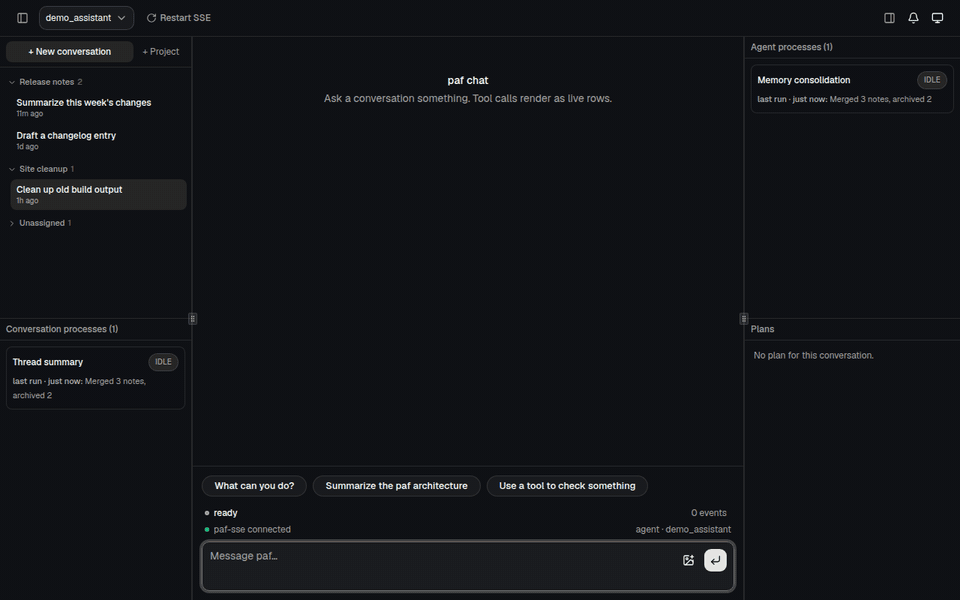
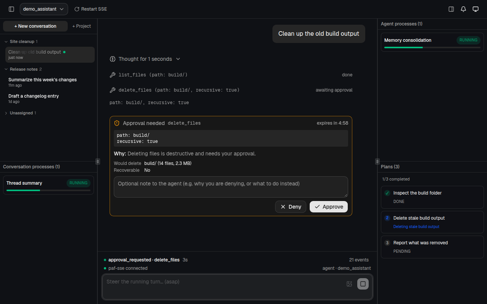
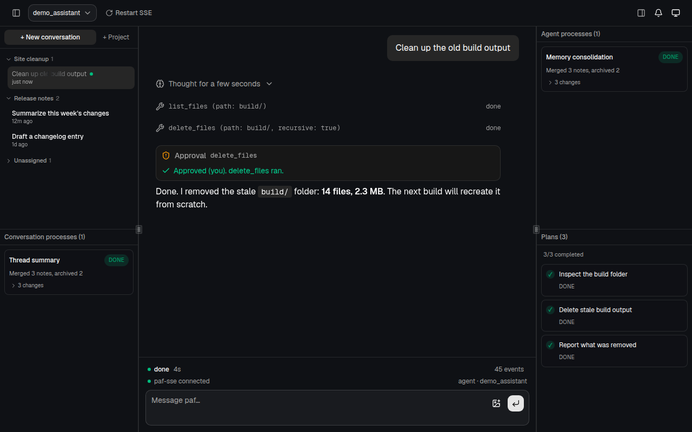
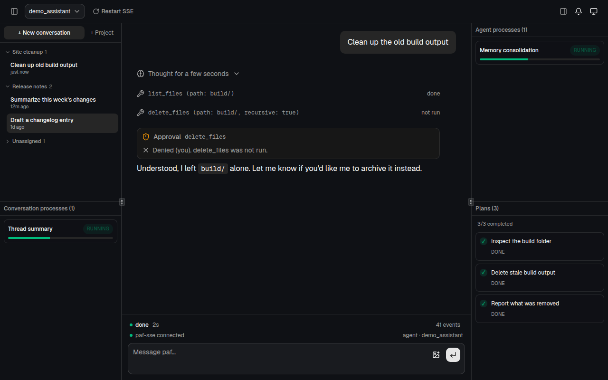
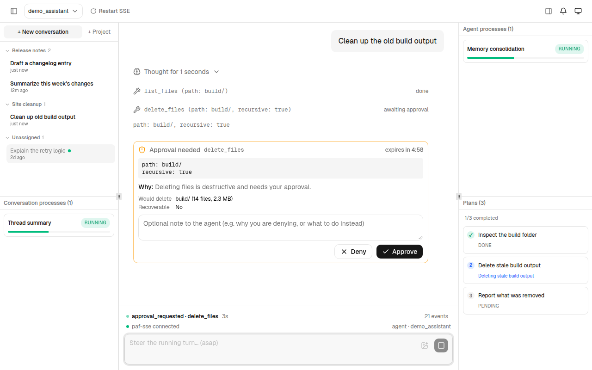
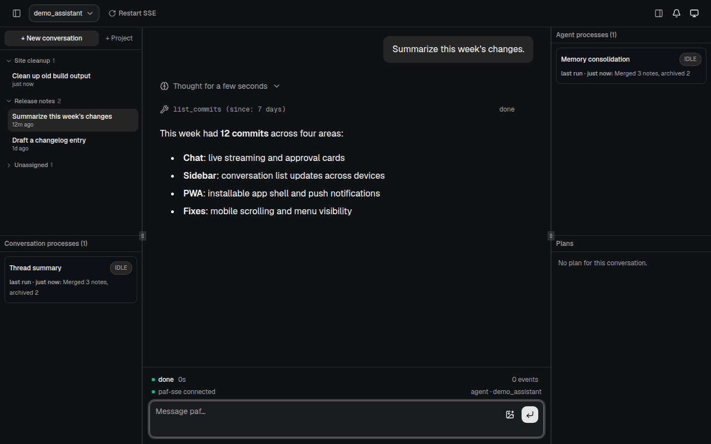
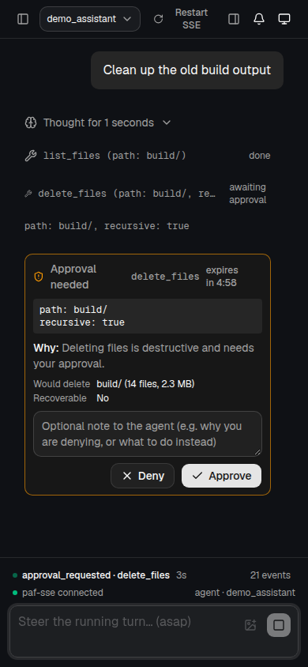

# paf-ui

A chat web UI for **paf**, the Pydantic agent framework.

> **This repo is a frontend only and does not work on its own.** It talks to a
> running [paf](https://github.com/landonmclain/paf) backend (its SSE server, and optionally its ops service)
> over HTTP. Without paf, the page loads but has nothing to connect to. It is
> published as a portfolio demo of the client side: streaming chat over SSE,
> tool-call approval cards, plans and background-process panels, live
> multi-device conversation lists, and an installable PWA with Web Push.
> A scripted mock backend with fake data is included, so you can still click
> through the UI (see [Try it without paf](#try-it-without-paf)).



## Stack

Next.js (App Router), React 19, TypeScript, Tailwind CSS v4, and a few
vendored [shadcn/ui](https://ui.shadcn.com) and
[AI Elements](https://github.com/vercel/ai-elements) components.

## Screenshots

| | |
| --- | --- |
|  |  |
| Tool call waiting on approval, with plan and process panels | Approved, tool ran, answer streamed |
|  |  |
| Denied, tool not run | Light theme |
|  |  |
| Restored conversation | Mobile layout |

All screenshots use the bundled mock backend and fake data.

## Try it without paf

The mock backend serves scripted, fake data for the UI's endpoints (lanes, projects,
history, plan, a streamed turn with a tool-call approval, and the background-process
feed). It listens on `:8090`, the UI's default backend URL.

```bash
npm install
npm run mock   # terminal 1
npm run dev    # terminal 2, then send any message and approve the tool call
```

It only covers what the demo needs; it is not a general paf replacement.

## Running it with paf

You need a paf backend reachable from the browser first.

```bash
npm install
cp .env.example .env.local   # then edit; see below
npm run dev                  # http://localhost:3000
```

Requires Node 22+.

## Configuration

Set in `.env.local` (see `.env.example`):

| Variable | Purpose | Default |
| --- | --- | --- |
| `NEXT_PUBLIC_PAF_BASE_URL` | paf SSE server | `http://localhost:8090` |
| `NEXT_PUBLIC_PAF_OPS_URL` | paf ops service (restart button) | `http://localhost:8091` |
| `NEXT_PUBLIC_PAF_OPS_TOKEN` | bearer token for the ops service | empty |
| `NEXT_PUBLIC_PAF_AGENT` | agent spec the UI drives | `demo_assistant` |
| `NEXT_DEV_ORIGINS` | extra hosts allowed to reach the dev server | none |

`NEXT_PUBLIC_*` values are inlined into the client bundle, so the ops token is
visible to anyone who can load the page. Only use it on a trusted network.

## Scripts

- `npm run build` / `npm start` — production build and server
- `npm run lint` — ESLint
- `npm run test:sse` — SSE client protocol tests (`scripts/test-sse.mts`)
- `npm run mock` — scripted fake paf backend (`scripts/mock-paf.mts`)

## License

Apache-2.0, see [LICENSE](LICENSE). Vendored third-party components keep their
own licenses; see [NOTICE](NOTICE).
